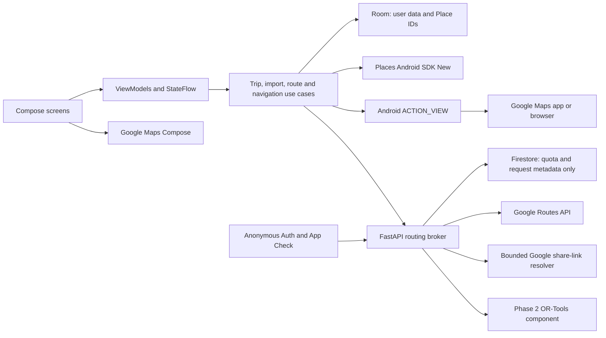

# RouteWise: Android Architecture and Contracts

Version: 0.1 | Date: 2026-11-09 | Status: proposed, not implemented

Read with [PRD](PRD.md) and [Delivery and provider evidence](DELIVERY.md). Provider facts below were checked against the sources in DELIVERY.md; implementation must recheck the selected SDK versions and applicable agreement.

## 1. Architecture Decisions

| ADR | Decision | Reason and trade-off |
|---|---|---|
| ADR-01 | Kotlin, Jetpack Compose, Material 3, Navigation Compose | Native Android behavior and share-intent integration; no web client |
| ADR-02 | Room is the authority for user trip data | Offline editing and simple ownership; no cloud sync or recovery after uninstall without export |
| ADR-03 | Google Maps SDK + Places SDK (New) on device | Supported mobile key restrictions and native UX; provider-specific data rules apply |
| ADR-04 | A narrow FastAPI routing broker from the first paid routing release | Keeps server credentials out of APK; adds one small service instead of a full trip backend |
| ADR-05 | Firebase anonymous Auth + App Check; Firestore only for bounded quota/idempotency metadata | No account UI, but authenticated, abuse-resistant billable endpoints; managed dependencies must be disclosed |
| ADR-06 | Server-managed credentials in Secret Manager, or workload identity/OAuth where supported | No service-account JSON in the APK or repository; static-IP restriction only if actually configured |
| ADR-07 | Fixed order and traffic-unaware route preview in MVP | Useful deterministic result, simpler costs; not an arrival-time or live-traffic promise |
| ADR-08 | Single-next-stop Maps handoff is authoritative | Avoids dependence on variable waypoint support and nonexistent arrival callbacks |
| ADR-09 | No disk persistence of provider payloads by default | Conservative compliance boundary; cold reopens require fresh details and incur cost |
| ADR-10 | OR-Tools in a later Python planning component | Proven optimization core; an LLM is not the routing or feasibility engine |
| ADR-11 | No PostgreSQL/PostGIS, Redis, Kafka, vector database, or agent framework in MVP | None is necessary for local trips and a small authenticated broker |
| ADR-12 | One Android app module with feature packages initially | Avoid Gradle/module overhead; extract a pure Kotlin planner module only when its reuse/test boundary warrants it |

The routing broker is not the employer's network proxy. They have unrelated purposes. All product cloud resources, billing, signing keys, and domains require a personal RouteWise owner and approval.

## 2. System Shape



Suggested Android packages: `trips`, `stops`, `search`, `imports`, `routing`, `navigation`, `sharing`, `settings`, `data/local`, `data/google`, `data/remote`, and `core/model`.

Use a conventional unidirectional flow: UI event -> ViewModel/use case -> repository -> StateFlow -> UI. Room flows represent durable edits; runtime route/detail state is separate. Coroutines use structured concurrency, cancellable owners, IO dispatchers, and bounded request fan-out. Hilt is the proposed DI choice; avoid inventing a service locator.

Use Kotlin serialization for owned JSON contracts and a mature HTTP client, for example Retrofit/OkHttp. Use official Maps Compose integration, Android Sharesheet, Storage Access Framework, and FileProvider. Pin compatible versions in a version catalog at project setup; no unverified version numbers are prescribed here.

### State and Revision Rules

- Every plan mutation increments `Trip.revision` in the same Room transaction.
- Progress has its own revision so a Visited action does not invalidate a full-day geometry merely because the user resumed the app.
- A route calculation captures an immutable snapshot: trip revision, day ID, ordered visit IDs, anchors, provider references, travel mode, and options.
- Calculate a canonical SHA-256 fingerprint from those inputs. Stable IDs, not marker numbers or localized names, identify legs.
- Apply a response only if its snapshot is still current. Otherwise discard it and leave the UI in an explicit stale/not-calculated state.
- Search results are correlated to a query generation. A slower earlier query never replaces a newer result list.
- Do not serialize provider responses into SavedStateHandle, disk HTTP caches, logs, analytics, crash reports, or Android backups.

## 3. Local Database Schema

Identifiers are UUID strings. Timestamps are UTC instants stored as epoch milliseconds; dates are ISO local dates; local wall times are paired with an IANA timezone. Distances are integer metres and durations integer seconds. Display-unit conversion happens at the UI boundary.

### MVP Durable Tables

| Table | Columns and constraints |
|---|---|
| `trip` | `id` PK; `title` nonempty <=120 chars; `timezone_id` default `Asia/Kolkata`; `start_date`/`end_date` nullable and ordered; `revision` >=0; `created_at`; `updated_at` |
| `place_ref` | `id` PK; `trip_id` FK cascade; `kind` = `GOOGLE_PLACE_ID` or `USER_COORDINATE`; `google_place_id` nullable; `user_latitude`/`user_longitude` nullable; `user_label` nullable <=120 chars; `created_at`; `updated_at` |
| `trip_day` | `id` PK; `trip_id` FK cascade; `ordinal` >=0; optional `local_date`; optional `user_title`; nullable `start_place_ref_id` and `end_place_ref_id`; UNIQUE(`trip_id`,`ordinal`) |
| `stop` | `id` PK; `trip_id` FK cascade; `place_ref_id` FK; nullable `day_id` FK; `position` >=0; `visit_duration_seconds` default 3600, range 0..86400; `priority` = `MUST_VISIT` or `OPTIONAL`, default `MUST_VISIT`; `notes` <=4000 chars; `visit_state` = `PLANNED`,`VISITED`,`SKIPPED`; nullable `state_changed_at`; timestamps |
| `navigation_progress` | `trip_id` PK/FK cascade; `day_id`; `target_kind` = `VISIT` or `DAY_END`; nullable `target_stop_id`; `plan_revision`; `progress_revision`; nullable `last_launch_at`; nullable `last_user_action_at` |
| `pending_import` | `id` PK; sanitized user-shared URL or independently entered query; `source_kind`; `delivery_nonce`; nullable trip/day target; state `PENDING`,`NEEDS_CONFIRMATION`,`FAILED`; error category; `created_at`; user-visible delete control |
| `app_preferences` | Singleton: units, selected local trip ID, privacy/consent version, preferences. Authentication secrets belong to the authentication SDK, not this table. |

### Invariants

1. A GOOGLE_PLACE_ID row requires a Place ID and has null coordinate columns. A USER_COORDINATE row requires finite latitude [-90,90] and longitude [-180,180], and no Google Place ID.
2. `user_label` is independently entered text, not an automatically copied Google name. The runtime display can prefer current provider text with attribution, but the durable label retains its provenance.
3. All anchors, stops, days, and progress targets belong to the same trip. Enforce composite foreign keys or equivalent transactional checks, not just UI validation.
4. Assigned positions are unique within a day. Unassigned positions are unique within the trip's inbox. Room migrations can create the necessary partial unique index for null-day inbox rows.
5. A repeated attraction visit has its own `stop.id`; it can reference the same `place_ref`.
6. Reordering is a two-phase transaction to avoid unique-position collisions: temporarily offset positions into an unused positive range, then write the new dense sequence. Never expose the intermediate order to observers.
7. Deleting a day first moves its visits to Unassigned in order; deleting a trip cascades. Do not cascade-delete every visit when only its day is deleted.
8. A visited/skipped status changes only from an explicit user event, not an Intent or location heuristic.
9. Deleting the current navigation target atomically clears or advances the cursor after confirmation; no dangling target ID.
10. Google coordinates and provider descriptions are not durable columns in this MVP. Do not put an arbitrary JSON provider response into a generic cache column.

Indexes: `stop(trip_id,day_id,position)`, `place_ref(trip_id,google_place_id)`, `trip(updated_at)`, `pending_import(state,created_at)`, and composite FK lookup indexes. There is deliberately no uniqueness constraint on provider ID across visits.

### Runtime Data, Not Room Entities

`PlaceSnapshot`: Place ID, current provider display name/address/location, attribution, fetched time, request generation. Holds only information needed by the active trip screen.

`RoutePreview`: calculation ID, snapshot fingerprint, day ID, calculation time, segments, legs, polyline, totals, provider warnings, complete/partial state. Dispose when the active trip session ends or the process dies; no persistent response replay cache.

`PlanningProposal` (R2): proposed day assignment/order, timing estimates, assumptions, warnings, exclusions, solver status, and provider snapshot references. Retention and export of derived timing/route data require the separate licensing decision; do not assume computed data is automatically exempt.

### Optional Future Coordinate Cache

Google's current service terms permit some latitude/longitude caching for up to 30 consecutive days. This is not permission to cache all fields. MVP avoids this cache entirely. Any future cache needs source-specific policy, retrieval/expiry timestamps, deletion and backup behavior, and a plan for expiry when Android background work is delayed.

### Backend Persistence

MVP Firestore collections contain only:

- UID-scoped quota buckets and global daily provider-event counters.
- Idempotency-key hash, canonical input hash, status, dispatch count, and expiry (24 h); no Google response body.
- A limited pilot allowlist/kill-switch configuration and app-version policy.

No trip-content sync and no provider-location analytics. TTL cleanup is supplemented with expiry checks at read time. Logs retain redacted request IDs, status, latency, and provider-event counts for a proposed 7 days, subject to owner approval.

PostgreSQL becomes useful for cloud accounts/collaboration or durable planning jobs, not merely because the app uses coordinates. PostGIS is optional later for appropriately licensed/user-supplied spatial data; it is not permission to index Google Places content or run prohibited spatial analyses.

## 4. API Contracts

All examples are proposed RouteWise contracts, not Google request schemas. The first release implements only the MVP endpoints. No endpoint is deployed by this document.

### Shared Rules

- HTTPS only; UTF-8 JSON; versioned `/v1` paths.
- Paid endpoints require `Authorization: Bearer <Firebase ID token>` and a verified `X-Firebase-AppCheck` token. Validate issuer, audience, expiry, app identity, and UID; neither an installation UUID nor a static APK secret replaces authentication.
- A credential-free `/healthz` returns health only, no configuration or upstream data.
- Reject unknown/unsupported fields in v1 request objects. Apply string, array, numeric, and body-size bounds before upstream requests.
- Use explicit integer units and RFC 3339 timestamps. Reject NaN, infinity, impossible coordinates, and duplicate waypoint-instance IDs.
- Errors use a stable `code`, user-safe `message`, `requestId`, and optional structured `details`. Never return credentials or raw provider error bodies.
- Request size: 64 KiB for a route batch, 16 KiB for shared-link resolution, 256 KiB for the R2 solver. These transport limits do not limit locally saved stops.
- Per-install pilot allowance proposed: 10 paid operations/minute and 100 route-batch dispatches/day, plus IP/global protections. Final values depend on an approved aggregate budget; client-side Places quota is configured separately.
- A new anonymous identity must not grant an attacker unlimited global spend: require app attestation, pilot admission, IP protections, Google project quotas, and a global fail-closed budget counter.
- Use idempotency keys to prevent duplicate dispatch. Coalesce only active in-flight work. Persisting an idempotency receipt is not permission to cache Google responses.
- An already-completed request whose runtime response is gone returns `409 RESULT_NOT_RETAINED`; the user can explicitly initiate a new calculation with a new key. Different payload with the same key returns `409 IDEMPOTENCY_CONFLICT`.
- Charge reservation occurs atomically before dispatch. A response timeout after dispatch does not automatically refund provider usage; provider billing can still occur.
- Initial broker deployment: one FastAPI service on Cloud Run, max two instances and controlled concurrency, with distributed counters. These caps constrain resource use but are not an exact monetary spending cap.

### Endpoint Summary

| Endpoint | Phase | Request | Response |
|---|---|---|---|
| `GET /v1/config` | MVP | Authenticated client version | Supported capabilities, provider batch limits, operational allowances, route kill-switch; no secrets |
| `POST /v1/routes:computeBatch` | MVP | Ordered 2..27 waypoint instances, revision/fingerprint, allowed driving profile | Ordered legs, encoded polyline, totals, warnings, or typed failure |
| `POST /v1/places:resolveSharedLink` | MVP | One recognized Google Maps HTTPS link | A parseable Place ID/coordinate candidate, or `NEEDS_USER_SEARCH`; never scraped place details |
| `POST /v1/plans:solve` | R2 | 1..50 selected visits, 1..7 days, explicit constraints | A feasible/conditional proposal, proven validation conflict, or no solution within budget |

Places autocomplete/details use the native SDK directly; do not relay arbitrary URLs or Google field masks through the broker. `/v1/config` limits are server controlled; APK configuration is not trusted.

### Route Batch Request

The `Idempotency-Key` header is a UUID unique to this calculation attempt and batch. `waypoints` contains origin, intermediate visits, and destination in order. The server maps this to Google `origin`, `intermediates`, and `destination`.

```json
{
  "tripRevision": 12,
  "inputFingerprint": "aaaaaaaaaaaaaaaaaaaaaaaaaaaaaaaaaaaaaaaaaaaaaaaaaaaaaaaaaaaaaaaa",
  "batchIndex": 0,
  "travelMode": "DRIVE",
  "routingProfile": "STATIC_ORDERED",
  "waypoints": [
    {
      "instanceId": "11111111-1111-4111-8111-111111111111",
      "reference": {
        "type": "USER_COORDINATE",
        "latitude": 26.9124,
        "longitude": 75.7873
      }
    },
    {
      "instanceId": "22222222-2222-4222-8222-222222222222",
      "reference": {
        "type": "USER_COORDINATE",
        "latitude": 26.9239,
        "longitude": 75.8267
      }
    }
  ]
}
```

The coordinates above are illustrative user inputs, not verified entrance locations. The alternate `reference` shape is `{"type":"GOOGLE_PLACE_ID","placeId":"<opaque-provider-id>"}`. The two shapes are exclusive. Place IDs are opaque and length-bounded, not validated by a guessed `ChIJ` prefix.

`STATIC_ORDERED` fixes `routingPreference=TRAFFIC_UNAWARE`, `optimizeWaypointOrder=false`, `computeAlternativeRoutes=false`, no traffic polyline, no toll-price computation, and intermediate `via=false` to obtain stop-to-stop legs. Client requests cannot escalate the field mask or feature/SKU tier. The server requests only route distance/duration, route/leg polyline as needed, and leg distance/duration.

For MVP all-route summary duration is driving time, not visit, meal, waiting, parking, or hotel time. No artificial timestamp represents a predicted arrival.

### Route Batch Response

```json
{
  "requestId": "33333333-3333-4333-8333-333333333333",
  "tripRevision": 12,
  "inputFingerprint": "aaaaaaaaaaaaaaaaaaaaaaaaaaaaaaaaaaaaaaaaaaaaaaaaaaaaaaaaaaaaaaaa",
  "batchIndex": 0,
  "status": "COMPLETE",
  "computedAt": "2026-11-09T12:00:00Z",
  "estimateBasis": "TRAFFIC_UNAWARE",
  "storagePolicy": "ACTIVE_SESSION_ONLY",
  "polylineEncoding": "GOOGLE_ENCODED_POLYLINE_5",
  "encodedPolyline": "_p~iF~ps|U_ulLnnqC_mqNvxq`@",
  "legs": [
    {
      "fromInstanceId": "11111111-1111-4111-8111-111111111111",
      "toInstanceId": "22222222-2222-4222-8222-222222222222",
      "distanceMeters": 4200,
      "durationSeconds": 780
    }
  ],
  "totalDistanceMeters": 4200,
  "totalDrivingDurationSeconds": 780,
  "warnings": ["NO_LIVE_TRAFFIC", "VISIT_TIME_NOT_INCLUDED"]
}
```

This is a serialization example only: the sample encoded polyline is illustrative and does not represent the sample coordinates. Live tests must validate provider-derived geometry and endpoint correspondence rather than comparing against this placeholder.

The response contains exactly `waypoints.size - 1` legs. Leg IDs must match consecutive input instance IDs and totals must equal the leg sums. Any structural mismatch is a provider-adapter failure, not a partial success to hide. If no complete route is returned for the requested batch, respond with an error; client aggregation represents partial coverage across batches.

### Error Contract

```json
{
  "error": {
    "code": "ROUTE_UNAVAILABLE",
    "message": "No driving route was found for this segment.",
    "requestId": "33333333-3333-4333-8333-333333333333",
    "details": {
      "batchIndex": 0,
      "retryable": false
    }
  }
}
```

HTTP mapping: 400 `INVALID_INPUT`; 401 `AUTH_REQUIRED`; 403 `APP_NOT_VERIFIED`/`PILOT_NOT_ADMITTED`; 409 idempotency conflict/result not retained; 413 `PAYLOAD_TOO_LARGE`; 422 `ROUTE_UNAVAILABLE`; 429 `QUOTA_EXHAUSTED` with `Retry-After` when meaningful; 502 `PROVIDER_FAILURE`; 503 `ROUTING_DISABLED`; 504 `PROVIDER_TIMEOUT`.

On 429 obey the returned backoff and stop the current calculation when the day/global budget is exhausted. For retryable transport/5xx failures use at most two retries with jitter and the same idempotency key. A post-dispatch ambiguous timeout requires checking the receipt; never blindly start a new paid request.

### Shared-Link Resolution

Input example: `{"url":"https://maps.app.goo.gl/example"}`. The string is illustrative, not a working place link.

Response types:

- `PLACE_ID_CANDIDATE`: opaque Place ID and canonical Google reference URL; Android fetches official details and asks the user to confirm.
- `COORDINATE_CANDIDATE`: coordinates explicitly found in documented destination/query parameters, not a viewport. These remain unconfirmed until the user sees the map.
- `NEEDS_USER_SEARCH`: safe reference URL and optional user-supplied text query; do not invent a place.
- Typed error for an unsafe/invalid URL.

Resolver boundary: allow explicitly enumerated Google Maps hosts, HTTPS port 443, no userinfo, at most three redirects, five-second deadline, bounded response headers/body, no cookies/authentication forwarding, and no HTML scraping. Revalidate scheme/hostname/DNS result at every hop; block loopback, private, link-local, metadata-service and reserved IP ranges, including IPv6. Pin validated DNS addresses for the connection and reject rebinding. Broad `*.google.com` or suffix-only checks are insufficient. Client/browser opens only canonical allowlisted references; no arbitrary redirect proxy.

If the redirect chain does not expose a documented stable destination parameter, fall back. Do not keep adding brittle parsing of Maps internal `data=` tokens just to claim higher automation coverage.

### Trip Export Contract

MIME for the pilot: `application/json`, file suffix `.routewise.json`; import through Storage Access Framework or supported share delivery. Limit file size to 2 MiB per import operation. This is a safe parser bound, not a saved-stop cap; offer partitioned exports/imports for larger user collections rather than silently truncating.

```json
{
  "format": "routewise-trip",
  "schemaVersion": 1,
  "exportedAt": "2026-11-09T12:00:00Z",
  "trip": {
    "title": "Jaipur weekend",
    "timezoneId": "Asia/Kolkata",
    "startDate": null,
    "endDate": null,
    "days": [
      {"ref": "day-1", "ordinal": 0, "title": "Old city", "startPlaceRef": "hotel", "endPlaceRef": "hotel"}
    ],
    "places": [
      {"ref": "hotel", "type": "USER_COORDINATE", "latitude": 26.9124, "longitude": 75.7873, "userLabel": "Our hotel"},
      {"ref": "visit-a", "type": "USER_COORDINATE", "latitude": 26.9239, "longitude": 75.8267, "userLabel": "Morning stop"}
    ],
    "stops": [
      {"ref": "stop-1", "placeRef": "visit-a", "dayRef": "day-1", "position": 0, "visitDurationSeconds": 3600, "priority": "MUST_VISIT", "notes": "Meet our friends"}
    ]
  }
}
```

`ref` values are file-local identifiers, never database IDs. Check all cross-references, unique refs, contiguous valid day positions, provider-reference union, text/range bounds, and absence of forbidden provider payload fields. Missing nullable fields follow documented defaults; missing required fields fail. Read/write v1 only; future unknown versions fail explicitly. Import regenerates UUIDs, resets progress, and commits atomically. Do not deserialize polymorphic arbitrary classes or fetch arbitrary embedded URLs.

## 5. Routing More Than 50 Stops

### A. Saved Collection Versus Route Request

Persisting 50, 100, or 500 user visits does not require submitting them in one provider call. The editable collection has no product stop-count cap. Each API request and external navigation handoff has separate constraints.

For one selected day, let ordered nodes be `P[0..N-1]`, including start and end. There are `N-1` consecutive legs. Google Compute Routes currently accepts at most 25 intermediate waypoints: at most 27 total nodes and 26 legs per request.

Default batch capacity is 27 nodes. For `N >= 2`, request count is `ceil((N-1)/26)`. Batches advance by 26 nodes, reusing the last node as the next origin:

```text
start = 0
while start < N - 1:
    end = min(start + 26, N - 1)
    submit P[start..end], inclusive, unchanged order
    start = end
```

This is specification pseudocode, not application implementation.

### B. Worked 50-Visit Example

- 50 attractions plus explicit start/end = 52 nodes, 51 legs.
- Batch 0: P0..P26, 27 nodes, 26 legs, 25 intermediates.
- Batch 1: P26..P51, 26 nodes, 25 legs, 24 intermediates.
- Shared node P26 is a boundary only: its visit is not duplicated and there is no duplicate travel leg.
- Two Pro-tier requests under the current 11-25 intermediate waypoint trigger, even with no traffic or optimization features.
- Merge by `(fromInstanceId,toInstanceId)` and expected global leg index, never arrival order of network responses.
- Keep each provider polyline as a segment. Preserve snapped endpoints; do not invent a road connector if independently computed boundary access differs. Flag a discontinuity for inspection.
- Sum validated legs once. Do not sum batch origin/destination dwell or count a boundary visit twice.

If 50 visits are spread across five days, route each day's explicit anchors/order independently. There is no imaginary zero-time overnight move between different hotel anchors. Total request count is the sum of daily batch counts, not necessarily two.

### C. Editing and Failure Handling

- Saving/reordering never triggers a billable recomputation automatically.
- An explicit calculation shows expected batch count before launch and consumes server-enforced quotas.
- For static estimates, use at most two concurrent batches. Map each response to its immutable input snapshot.
- Successful segments may be shown while another fails. Keep the failed span visibly unresolved and withhold full-trip totals/completion.
- A narrowly budgeted diagnostic retry may bisect a failed batch to identify a bad stop, but only with explicit user confirmation of extra calculation, not an uncontrolled recursive fan-out.
- Once travel-time-dependent scheduling is introduced, batch departure times must be chained through preceding driving, visits, waits, and breaks. Parallel batches sharing the same initial departure time cannot yield a valid day schedule.
- Never optimize each batch separately and call that a globally optimized trip. Route batching is transport/rendering, not optimization.

### D. Mandatory Boundary Tests

| Total route nodes | Expected requests | Expected covered legs |
|---|---|---|
| 0 | 0, invalid/no route | 0 |
| 1 | 0, nothing to drive | 0 |
| 2 | 1 | 1 |
| 12 | 1 | 11 |
| 27 | 1 | 26 |
| 28 | 2 | 27 |
| 52 | 2 | 51 |
| 53 | 2 | 52 |
| 54 | 3 | 53 |
| 102 | 4 | 101 |
| 502 | 20 | 501 |

All tests assert: batch length 2..27, every adjacent pair exactly once, same global order, consecutive batches share precisely their boundary node, no fabricated leg, and no silent loss when a batch fails.

## 6. Google Maps Handoff

Reliable default URL shape:

```text
https://www.google.com/maps/dir/?api=1&destination=DESTINATION&destination_place_id=PLACE_ID&travelmode=driving&dir_action=navigate
```

Use a platform URI builder. Supply `destination` even when `destination_place_id` is present. For a Google Place ID, a currently resolved coordinate or current provider name can supply the destination parameter within the active session; if it is unavailable offline, retain the trip and offer online resolution rather than silently substituting an unrelated label. For independent user coordinates, encode the coordinate directly and omit the Place ID field.

An explicit planned origin often leads to a route preview if it is not near the actual traveller. A `navigate` parameter requests navigation but does not guarantee it for every product/location. Never interpret a successful Intent as confirmation of navigation or arrival.

Optional chunk policy: at most three intermediate waypoints as a conservative cross-platform ceiling, subject to a final URL length <=2,048 characters. Native-supported destinations may allow more, but do not assume that from the Android package alone. Shorten a chunk until it fits without losing visit identity; if one destination cannot be represented, show a resolvable fallback rather than truncating a URL.

Every waypoint Place ID must have a corresponding positional `waypoints` item. Preserve exact order. For a browser/product that ignores waypoints, the user must be able to select next-stop navigation immediately; single-leg handoff is the only MVP behavior promised across supported products.

Use explicit Google Maps package targeting when installed, catch `ActivityNotFoundException`, then use a generic HTTPS Intent. Declare only the necessary package visibility query. RouteWise cannot force Maps to use the exact preview polyline or transfer an unlimited route into a consumer navigation session.

## 7. Intelligent Scheduling Engine: R2 Design

### Inputs and Supported Envelope

- 1..50 selected confirmed visits for optimization, 1..7 travel days in the first solver release. Larger saved trips remain usable manually; this is a solver resource limit, not a stop-storage limit.
- Known start/end anchor for every day. Different overnight hotels must be supplied by the user; no automatic hotel selection.
- Dated local day start/end, timezone, max driving seconds, pace, hard/soft preferences, visit durations, mandatory/optional flags, and manual locks.
- Opening intervals and exceptions with source/fetched time; business status; independently provided overrides clearly identified.
- Meal/rest requirements and, when available, verified candidate places with actual detour and opening-window costs.
- Initial India-only planning zone is `Asia/Kolkata`. Model timestamps in UTC and retain source zone; international/DST support needs additional release tests.

### Request Shape

```json
{
  "tripRevision": 20,
  "mode": "OPTIMIZE",
  "timezoneId": "Asia/Kolkata",
  "days": [
    {
      "dayId": "44444444-4444-4444-8444-444444444444",
      "date": "2026-12-05",
      "departureLocalTime": "08:30:00",
      "finishByLocalTime": "18:00:00",
      "maxDrivingSeconds": 14400,
      "startRef": "hotel",
      "endRef": "hotel"
    }
  ],
  "places": [
    {"ref": "hotel", "type": "USER_COORDINATE", "latitude": 26.9124, "longitude": 75.7873},
    {"ref": "visit-a", "type": "USER_COORDINATE", "latitude": 26.9239, "longitude": 75.8267}
  ],
  "visits": [
    {
      "visitId": "55555555-5555-4555-8555-555555555555",
      "placeRef": "visit-a",
      "priority": "MUST_VISIT",
      "visitDurationSeconds": 3600,
      "allowedDayIds": ["44444444-4444-4444-8444-444444444444"],
      "lockedSequencePosition": null,
      "userOpeningWindows": [
        {"date": "2026-12-05", "opensLocalTime": "09:00:00", "closesLocalTime": "17:00:00"}
      ]
    }
  ],
  "preferences": {
    "pace": "BALANCED",
    "avoidDrivingAfterDark": true,
    "unknownOpeningHoursPolicy": "WARN",
    "lunch": {"required": true, "earliestLocalTime": "12:00:00", "latestEndLocalTime": "14:30:00", "durationSeconds": 2700},
    "rest": {"maxContinuousDrivingSeconds": 7200, "minimumBreakSeconds": 900}
  }
}
```

These are user constraints, not trusted claims about current provider hours. The server independently resolves provider data when requested/allowed, retains provenance, and never accepts arbitrary client matrix costs as authoritative.

### Pipeline

1. Validate units, dates, anchors, coordinates/references, duplicates as visits, contradictory locks, and service durations. Return precise input conflicts before expensive calls.
2. Obtain current provider data within approved licensing. A future date beyond a current-hours horizon is not certified by today's `isOpen` value. Weekly hours are indicative; special closures, last admission, and seasonal changes can remain unknown.
3. Normalize opening periods into half-open dated intervals, including overnight periods and multiple daily openings. The entire visit must fit; arrival before closing is insufficient. Prefer verified special-date exceptions over weekly templates; never infer open from absent data.
4. Fetch a directed travel-time matrix only for the selected planning set and required anchors. Do not assume symmetry or substitute straight-line distance as a driving estimate.
5. Apply cheap necessary-condition checks: impossible fixed windows, visit longer than every available opening, individually unreachable mandatory visits, and minimum travel/service time exceeding available days. Necessary checks do not prove all other cases feasible.
6. Construct an OR-Tools routing/time-window model. Use one vehicle per day as a mathematical device, not a claim of multiple travellers. Each vehicle has its real day anchors and absolute start/end windows.
7. Mandatory visits are hard constraints. Optional visits may be dropped with explicit penalties/preferences and must appear in `unplacedVisits` with an explanation. Model allowed days and fixed positions explicitly.
8. Use separate dimensions for elapsed time and driving time: elapsed includes visits, wait, breaks, and travel; daily driving limits include driving only. Add break constraints for continuous driving, not merely total daily duration.
9. Produce an initial solution using established OR-Tools heuristics and bounded local search. Use a documented objective: satisfy all hard constraints, maximize optional priority value, then minimize travel/wait and day imbalance. Do not use an arbitrary penalty so small that saving travel drops a must-visit stop.
10. Re-evaluate the selected route legs at their predicted departure times if time-dependent travel is available for that date. OR-Tools' ordinary static transit callback does not automatically solve a time-dependent routing problem. Use frozen scenarios and a bounded solve/validate loop, not hidden mutable callbacks.
11. Limit refinement to two rounds and a proposed 20-second solver budget within a 60-second end-to-end request deadline. On timeout return a valid best-known proposal or `NO_SOLUTION_WITHIN_BUDGET`; never relabel timeout as infeasibility.
12. Run an independent schedule validator after solving. Check every hard constraint, all mandatory visit IDs, interval coverage, all legs, meal/rest rules, cumulative driving, day anchors, and preserved locks. Invalid proposals are rejected, not rendered as feasible.

### Time Equations

For a predecessor visit i and next visit j:

```text
arrival[j] = departure[i] + travel_seconds(i, j, departure[i])
start[j] = earliest permitted start >= arrival[j]
departure[j] = start[j] + visit_duration[j]
wait[j] = start[j] - arrival[j]
opening constraint: open[j] <= start[j] AND departure[j] <= close[j]
day driving = sum(driving legs), excluding visits, waiting and breaks
```

The initial static model approximates `travel_seconds` with a directed matrix per scenario/day. Later validation must not pretend this approximation accounts for all traffic changes.

### Matrix Scaling and Billing

- An all-pairs set of 50 points has 2,500 elements; 50 visits plus two distinct anchors has 52 points and 2,704 elements. Reused hotel anchors may reduce distinct points but not repeated visit IDs.
- Standard nontransit matrices allow 625 elements per request; with Place IDs/addresses total origin+destination count <=50. Use tiles of at most 25 origins by 25 destinations, respecting both constraints.
- 52 points need a 3-by-3 tile grid with edges of size 25,25,2: nine requests, still 2,704 billed elements, not nine billed elements.
- Traffic-aware-optimal uses the lower 100-element cap; 10-by-10 tiles produce a 6-by-6 grid for 52 points. Multiple time buckets multiply billed elements.
- The documented default matrix quota is 3,000 elements/minute, so even one 52-point dense solve nearly consumes a minute's default quota. Gate/queue requests and reserve element budget before dispatch.
- Preserve origin/destination indices because results may not arrive in matrix order. Treat per-element failures as unreachable edges, not zero duration.
- Do not permanently store matrices for reuse across users. Any legal caching exception must be confirmed before changing this conservative design.
- For larger instances, reduce the planning scope, use approved lower-cost data, or validate an alternative solver/provider product. Never call independently optimized geographic batches globally optimal.

### Meals, Rest, and Daylight

- A lunch window reserves time; it does not invent a restaurant. Prefer a user-supplied meal place or a small number of verified provider candidates, including detour/parking/visit time and opening constraints.
- Where a meal or safe rest location cannot be verified, return a placeholder with an explicit unconfirmed-location warning. A strict mandatory break requirement cannot be declared fully satisfied by an invented zero-cost stop.
- Add one chosen meal candidate per required group/day, not all restaurants. Candidate search is a separately capped, billable operation.
- Use an established, appropriately licensed sunrise/sunset implementation/data source for no-after-dark constraints. Check complete driving intervals, not only attraction opening times; conservative daylight bounds must cover the relevant route locations.
- No-after-dark and max-driving are hard constraints when enabled. Relax them only through an explicit changed request confirmed by the user.
- Respect full-day closures, temporarily/permanently closed venues, unknown last-admission rules, and user booking windows.

### Solver Outcomes and Response

Return `status` as one of `FEASIBLE`, `CONDITIONAL`, `INFEASIBLE_INPUT`, `NO_SOLUTION_WITHIN_BUDGET`, `PROVIDER_DATA_UNAVAILABLE`, or `QUOTA_EXHAUSTED`.

Return `optimality` separately: `NOT_PROVEN` by default; only an actual certificate/proof permits `PROVEN_OPTIMAL`. Return `solverVersion`, `dataFetchedAt`, `assumptions`, `warnings`, `unplacedVisits`, `dayPlans`, and `tripRevision`.

Every scheduled visit returns visit ID, day ID, sequence, arrival, service start, departure, wait seconds, preceding driving seconds/metres, visit seconds, opening-hours source/confidence, and warnings. Unplaced visits include the original ID, required/optional flag, and a reason; suggestions never edit user intent automatically.

`FEASIBLE` still means feasible under stated input estimates. Missing hours/daylight/meal location or uncertain forecast data produces `CONDITIONAL` in warn mode; strict mode blocks such a plan. `INFEASIBLE_INPUT` requires a concrete contradiction or proven solver infeasibility, not a failed heuristic.

Pilot R2 uses a bounded synchronous solve. Asynchronous workers/durable jobs are deferred until measured need; adding them requires explicit retention/consent for job inputs and license-safe treatment of provider outputs.

### Deterministic Schedule Fixture

No meal/rest requirement in this synthetic fixture; constant 30-minute driving legs.

- Start 08:30 -> A arrival 09:00; A open 09:00-11:00; visit 60 min -> depart 10:00.
- A -> B arrival 10:30; B open 11:00-13:00; wait 30 min; visit 45 min -> depart 11:45.
- B -> end anchor arrival 12:15.
- Driving = 90 min; visits = 105 min; wait = 30 min; elapsed = 225 min.
- If B instead closes 11:30 while opening 11:00, its 45-minute mandatory visit cannot fit. Return the specific conflict, not a 11:45 departure labelled valid.

Additional fixtures: asymmetric travel, disconnected route, unknown hours, overnight hours, special closure, repeated place IDs as separate visits, mandatory unreachable stop, optional omission, conflicting locked days, stale provider data, break crossing lunch window, strict daylight conflict, and solver timeout with/without a valid incumbent.

### LLM Boundary

An optional later LLM can translate user prose into a schema-valid preference proposal and explain already-validated plans. It cannot invent coordinates, opening hours, route costs, feasibility, or silently change must-visit constraints. Structured output is validated before use; user confirmation is required for preference changes. Do not send Maps content to model providers or use it for training without verifying contractual permission and privacy requirements. The app must remain useful without any LLM.

## 8. Security, Operations, and Testing

- Backend server credentials never enter the APK. Android SDK keys are visible to determined attackers, so restrict them by package, signing certificate, and allowed APIs; use debug/release separation and attestation where supported.
- Use a personal billing account. Separate Android and server projects/keys as appropriate, but do not split accounts/projects to circumvent free caps or restrictions.
- Server endpoints expose fixed operations, never an arbitrary URL fetcher or unfiltered Google API relay.
- External URLs, import files, provider errors, and place names are untrusted data. Do not execute/render them as script or unsanitized HTML. Preserve required provider attribution through an approved rendering component.
- Bound input sizes, retries, concurrent calls, matrix elements, solver CPU time, and total daily dispatches. Fail closed if budget metadata cannot be read safely.
- Cloud budget alerts are notifications, not a reliable spending stop. Enforce application counters and provider quotas, and retain an emergency kill switch.
- No production credentials in emulator images or test fixtures. Use debug App Check only in a dedicated, capped environment.
- Reuse the user's existing approved ARM emulator bundle; discover its actual path and verify Google Play services/API level rather than reinstalling Android tooling blindly. Confirm personal-product use of the company-managed laptop against employer policy; account isolation alone does not establish approval or IP ownership.
- Unit tests cover parser, batching, identity, quota adapters, and schedule arithmetic; Room tests cover migrations/transactions; Compose tests cover flows and accessibility; physical-device tests cover real Maps handoff and intent returns.
- Test Google API contracts with recorded synthetic/provider-permitted fixtures and capped live smoke tests. Do not check real customer/provider payloads into a public repository.
- Release evidence includes APK/AAB provenance, signing verification, supported-device matrix, policy review, quota dashboard, and a documented rollback/kill-switch procedure.
