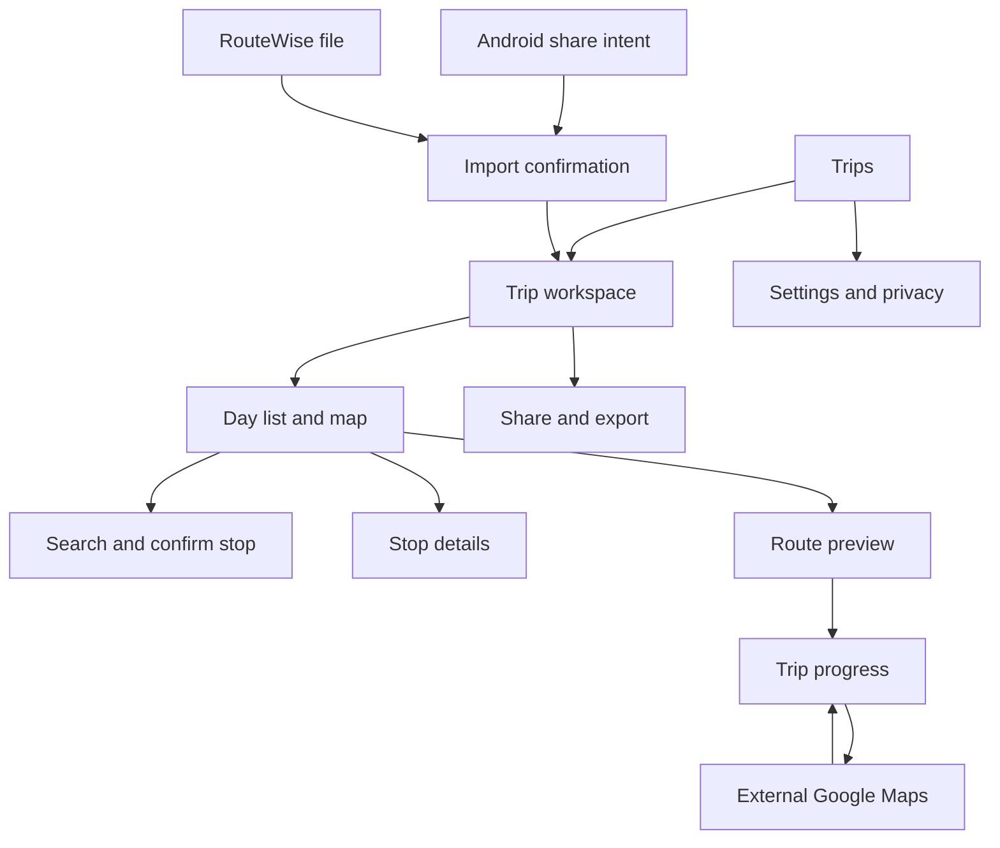

# RouteWise: Android MVP Product Requirements

Version: 0.1 | Date: 2026-11-09 | Status: proposed baseline, awaiting owner approval

RouteWise is a working name, not a cleared trademark. This is a specification, not an implemented app or a claim that the product hypothesis is validated.

Related documents: [Architecture and contracts](ARCHITECTURE.md), [Delivery, costs, and decisions](DELIVERY.md).

## 1. Product and Recommendation

RouteWise is a native Android trip organizer for self-drive leisure travellers in India. It turns a collection of places into an ordered, usable journey, using Google Maps for map display and external navigation.

Long-term promise: "Save the places you want to visit. Build a realistic journey around them."

MVP promise: "Keep all your stops together, arrange your days, and navigate one stop at a time."

Do not market the first release as an automatic itinerary optimizer. Automatic allocation of stops to days, opening-hours scheduling, and live replanning belong to subsequent releases.

### Recommended Launch Baseline

- Native Kotlin and Jetpack Compose, Android only; no website or WebView application.
- Private pilot with 10-20 invited testers before a public Play Store release.
- Primarily Indian road trips with 15-30 attractions over 2-7 days.
- No account UI, cloud trip synchronization, subscriptions, or advertising in MVP.
- Local Room persistence; users can explicitly export/import their own trip data.
- Google Maps SDK for display, Places SDK using Places API (New), Routes API through a narrow authenticated backend.
- No paid services enabled until the owner approves the billing account, usage ceilings, and operating budget.
- No fixed product limit on saved stops; validate 50, 100, and 500-stop trips, and 1,000-stop storage fixtures. Device resources and service quotas remain finite.
- Default external navigation is a single next destination. Multi-waypoint handoff is an optional convenience with a reliable single-leg fallback.

These are recommendations, not answers silently attributed to the owner.

## 2. Audience, Problem, and Validation

Primary user: an Android traveller who collects places in Google Maps and messaging apps, then manually arranges a holiday across several days.

Jobs to be done:

1. Capture a place while browsing without losing the current trip context.
2. Maintain a meaningful list beyond the navigation app's waypoint limit.
3. Group and reorder visits without repeatedly rebuilding Maps directions.
4. See whether a manually arranged day involves excessive driving.
5. Resume the next leg after visiting, skipping, or changing a stop.
6. Share a copy with a companion without requiring both people to create accounts.

Initial exclusions: fleet dispatch, professional delivery optimization, driver monitoring, commercial vehicle restrictions, public-transit planning, and international timezone complexity.

### Success Measures for the Pilot

Targets below are hypotheses to evaluate, not forecasts:

- At least 8 of 10 observed testers can create a trip, save five stops, reorder them, and launch the next destination without assistance.
- At least 90% of a consented, versioned set of supported Google Maps share formats reaches the correct confirmation screen; no silent incorrect imports in the fixture set.
- At least 95% of observed supported-device navigation launches open the intended destination or an explicit fallback. This measures launch, not arrival.
- At least 60% of activated testers return to a saved trip within seven days.
- At least five testers use the app on a real outing and describe a concrete advantage over their existing workflow.
- No lost stops in process-death, database-migration, reorder, and import acceptance tests.
- Measure Maps spend per activated trip and per route refresh before pricing decisions.

Telemetry is optional and minimized: event names, counts, coarse performance buckets, and error categories. Never collect raw coordinates, place IDs, search queries, shared URLs, notes, or trip titles for analytics. A navigation-launch event does not establish that a stop was visited.

Competitor validation must include Wanderlog, Roadtrippers, Furkot, RouteXL, Circuit, Roadie, TripYara, HopNow, and Sancharees. Do not claim that multi-stop or AI itinerary planning is novel. The hypothesis is lower Android capture/navigation friction, followed by trustworthy scheduling.

## 3. Exact MVP Scope

### Included: Release 0.1

| Capability | Commitment |
|---|---|
| Trips | Create, rename, duplicate, delete, and edit local trips |
| Places search | Autocomplete, select, inspect, and confirm a destination |
| Maps sharing | Receive individual Google Maps place links through Android Sharesheet, with confirmation and unsupported-link fallback |
| Stop collection | Save more than 50 stops without a product-level stop-count cap |
| Day organization | User-created days, optional dates, explicit start/end anchors, and an unassigned-stop inbox |
| Stop order | Drag-and-drop within a day; accessible move up/down and move-to-day commands |
| Stop preferences | User-entered visit duration, notes, and must-visit/optional designation; neither designation changes order automatically |
| Map | Numbered markers, selected-stop highlight, fit-to-day, and actual routed polylines when available |
| Route estimate | Distances and traffic-unaware driving durations in the selected order, fetched in valid batches |
| Navigation | Google Maps next-stop handoff, optional compatible chunks, explicit progress and resume |
| Persistence | Durable user-authored trip structure and permitted identifiers; see the Google-content boundary below |
| Sharing | Android Sharesheet text summary and versioned RouteWise JSON file; recipient imports an independent copy |
| Recovery | Offline list editing, pending imports, retryable routing errors, and process-death recovery |
| Privacy | Delete/export controls, clear third-party disclosure, no background location collection |

Manual day grouping is an intentional small addition to Phase 1: a multi-day road-trip organizer is difficult to evaluate with only one undifferentiated list. Automatic day assignment remains excluded.

### Explicitly Excluded

- Automatic order optimization or assigning visits to days.
- Opening-hours validation, departure/arrival schedules, traffic prediction, and a claim that an entire itinerary is feasible.
- Automatic meal/rest venue selection, restaurant recommendations, ticket booking, or hotel booking.
- In-app turn-by-turn navigation, Google Navigation SDK, Android Auto, or voice guidance.
- Continuous/background location tracking, geofences, automatic arrival detection, or live replanning.
- Importing a user's entire Google Maps Saved lists or scraping Google Maps pages.
- A guarantee that every Google Maps short link or shared route can be resolved automatically.
- Offline map downloads, offline road-route computation, or permanent storage/export of Google route data.
- Live collaboration, cloud trip backup/sync, social profiles, payments, subscriptions, and public trip discovery.
- Delivery fleets, multi-vehicle routing, toll-price calculation, two-wheeler routing, and commercial-vehicle constraints.
- LLM-generated schedules, autonomous agents, or model training on Maps content.
- iOS and web clients.

### Release Boundaries

- R0: prototype/spikes with synthetic data; not a customer MVP.
- R1: the complete routing MVP above. All its essential capabilities must pass acceptance before it is called MVP-ready.
- R2: deterministic day-wise scheduling and opening-hours checks, using OR-Tools after licensing and data-quality gates.
- R3: opt-in live progress/replanning, introduced only after static plans have demonstrated usefulness.

## 4. Functional Requirements

### FR-01: Trip Lifecycle

- A trip has an ID, user title, optional date range, timezone, days, anchors, stops, and revision.
- Create works offline; an empty trip is a valid draft, not a routing error.
- Save local edits transactionally without a separate global Save button.
- Deleting a trip requires confirmation; completed deletion cascades to its stops, days, progress, and pending imports.
- Duplicating creates new IDs and resets progress; never aliases mutable records between trips.
- Changing the trip date range must show affected days and move orphaned visits to Unassigned, not delete them.

### FR-02: Place Search and Selection

- Debounce search by 300 ms, minimum two meaningful characters, cancel obsolete UI results, and cap four in-flight detail resolutions.
- Use a new autocomplete session token per search/selection session; do not reuse tokens or mix New and Legacy endpoints.
- Bias toward the selected trip area when known; expose country/area changes rather than silently forcing India results.
- Require a confirmation screen before adding: resolved place, map position, destination identifier, optional independent user label, day, duration, and priority.
- Initially request only the fields needed for location selection. Do not request reviews, photos, ratings, or opening hours for MVP.
- Surface any ambiguity or closed/moved/inaccessible status actually reported by the provider before confirmation. MVP does not promise a comprehensive operating-status or opening-hours check for every place.
- If the same place is already present, offer "Use existing" or "Add another visit". Repeated visits are valid distinct Stop records.
- The user may save an unresolved shared place as Pending; it is not included in routing until confirmed.

### FR-03: Incoming Android Share

- Support `ACTION_SEND` with `text/plain` and explicitly supported URI fields; handle both cold-start and already-running activity delivery.
- Extract candidate URLs from text, not an assumed exact English template.
- Documented Maps search/directions URLs with an explicit destination/place ID can be parsed. A map viewport center is not proof of a destination.
- Recognized Google short links may be expanded with bounded HTTPS redirects only. Do not scrape destination HTML, decode undocumented binary Maps tokens as a stable API, or claim a short link always reveals a Place ID.
- If a link cannot be resolved through supported parameters, show a search/coordinate confirmation fallback with the original user-provided query available to the user.
- Select an existing trip or create one; choose a day or Unassigned. Do not mutate a trip until confirmation.
- Reject unexpected URI schemes, private-network redirect targets, oversized input, and executable/file URLs.
- On network failure, retain a user-visible pending import locally; never lose or silently retry it with unlimited API calls.
- Re-delivery from activity recreation does not duplicate a saved import. A new intentional user share can create another visit after confirmation.

### FR-04: Stops, Days, and Reordering

- Every saved visit is either Unassigned or belongs to exactly one day in its trip.
- Start/end anchors are distinct roles, not silently counted as numbered attraction visits. A hotel can be reused across days.
- Day creation supports undated plans; route estimates require anchors but not dates.
- Move operations update ordering in one Room transaction and increment the trip revision once.
- Dragging does not call Routes API. Recalculate only on an explicit action after the edit.
- Reordering preserves stable IDs, notes, durations, priorities, and already-visited state.
- Moving a visited stop into the future requires a confirmation to reset its progress; an ordinary reorder never resets it.
- Large saved collections remain editable when network quotas are exhausted.

### FR-05: Map and List

- A selected day's attractions have matching one-based marker/list numbers; Unassigned stops are not silently included in that route.
- Start/end markers use distinct symbols. Repeated coordinates remain discoverable through the list and an overlapping-marker chooser.
- Clustering may be used for large overviews; expanding a cluster reveals the original visit numbers.
- Show road-following polylines only from successful route results. Never draw straight lines and label them as calculated driving routes.
- Keep Google attribution unobscured by bottom sheets, buttons, keyboard, and system insets.
- If Maps cannot load, the list and editing remain usable with an explicit map-unavailable state.

### FR-06: Route Calculation

- Calculate only the user's confirmed day order. No hidden optimization and no dropped optional visits.
- Route nodes are an explicit start, the ordered visits, and an explicit end. Ask the user to select a start/end or choose a documented first/last-stop shortcut.
- A current-location start requires foreground permission and a fresh location; denied permission leaves manual start selection available.
- Use driving and traffic-unaware estimates for MVP, labelled as estimates without live traffic or visit time.
- Batch within provider limits, overlap boundary nodes once, and preserve every adjacent leg exactly once; see Architecture section 5.
- A result is associated with a trip revision and input fingerprint. Responses for an edited/replaced plan never overwrite the new plan.
- Show route state: not calculated, calculating, complete, partial, stale, unavailable, or quota reached.
- Complete totals exist only when every required leg succeeds. Partial results show covered legs and a partial subtotal, not a deceptively complete total.
- Provider no-route errors identify affected stops/batches. Never substitute zero travel time or skip a destination automatically.
- Cancellation is best effort; disclose that an already-started provider request can still consume quota.
- Route and Places response content is not persisted to disk by default. A killed process recalculates instead of restoring an unlicensed route cache.

### FR-07: Navigation and Progress

- "Navigate next" opens the next unvisited, unskipped attraction or the final end anchor in Google Maps.
- Omit origin for navigation from the traveller's actual location; use an explicit origin only for planned-route preview.
- Save the selected destination and current revision before handing off. `ACTION_VIEW` launch success is not arrival confirmation.
- On return, ask for/offer "Visited", "Skip", or "Continue navigation". Never mark visited simply because the app resumed.
- A stop may be skipped only by explicit user action, with an extra confirmation for must-visit stops.
- Persist progress across rotation, process death, external-app return, and relaunch.
- Detect Maps availability using narrow package visibility, catch launch failures, and fall back to a Maps HTTPS URL or a copyable destination reference.
- Compatible multi-waypoint chunks show exactly which stops are included and allow returning to per-stop navigation. Never promise automatic advancement between external Maps sessions.
- Navigation warnings must distinguish preview from live guidance and explain that Google may choose a different road route/ETA.
- No app interaction should be required while the driver is moving; changes are intended for a passenger or a safe stop.

### FR-08: Persistence and Offline Behavior

- Persist user-authored titles, labels, notes, order, day assignment, durations, flags, progress, and permitted Place IDs in app-private storage.
- Do not silently classify a Google-provided name/address as user-authored because a user tapped Save.
- Default: Google display names, addresses, opening hours, coordinates, polylines, distances, and durations are runtime data only. Coordinates have a limited caching exception, but MVP does not need to use it.
- Offline display uses the independent user label or a stable "Stop N" fallback; explain that fresh place details require connectivity.
- No claim of offline maps, Google road estimates, or uninterrupted offline Google navigation.
- Exclude runtime provider data and temporary exports from backups; initially disable automatic cloud backup of trips and provide explicit user export instead.
- Losing connectivity must not prevent renaming, reordering, adding notes, deleting, or marking a visit complete.

### FR-09: Sharing and Importing Trips

- Share a preview of the exact user data leaving the device before opening Android Sharesheet.
- Plain text includes user title/labels, day grouping, and Maps links. Do not export fetched Google business names or road-route content by default.
- RouteWise JSON contains schema version, user-authored structure, Place ID references, and independently supplied coordinates where applicable; never cached Google coordinates or raw provider payloads.
- Import validates size/schema/ranges and shows a summary before an atomic save with new local IDs.
- Unknown future schema versions produce a clear unsupported-version error, not partial data loss.
- Recipient receives an independent copy; changes do not synchronize back to the sender.
- Fresh Google details/routes are fetched by the recipient within their session and quota. Exporting references still needs the licensing gate documented in DELIVERY.md.
- Share files use `content://` FileProvider grants. Temporary export files expire after 24 hours and are excluded from backup.

### FR-10: Permissions, Preferences, and Deletion

- App works without location permission except current-location conveniences.
- Request coarse/fine foreground location only when the user requests it; tolerate approximate location. No background location or contacts/storage-wide permission.
- Settings include units, privacy information, attribution, export/delete data, and permission status.
- All-local-data deletion clears Room, pending imports, temporary exports, and locally held anonymous credentials; disclose separate Google/provider retention.
- No credentials, API keys, or personal location data in release logs, crash breadcrumbs, or screenshots collected for analytics.

### FR-11: Authentication and Usage Protection

- No user sign-in screen in MVP, but the routing backend must authenticate requests; an installation ID alone is not authentication.
- Use anonymous authentication plus app attestation for the proposed public-capable design; debug exceptions are limited to a separately capped nonproduction environment.
- Billing account, provider keys, limits, and emergency kill switch are owned by the personal RouteWise project, not the employer.
- Explicit route requests consume a documented, finite per-user and global allowance; users can still save/edit/export their own trip data at the limit.
- Missing credentials or an unavailable backend produce real unavailable states. Demo data must be visibly labelled and excluded from production.

## 5. User Flows and Screens

### Navigation Structure

| Screen | Main content/actions | Required states |
|---|---|---|
| Trips | Compact trip list, search titles, create, overflow duplicate/delete | Empty, populated, loading, storage error |
| Create/Edit trip | Title, optional dates, timezone; create day | Validation errors, unsaved form, delete confirmation |
| Trip workspace | Day selector, Unassigned, ordered stop list, map/list switch, add, calculate | Empty day, 50+ stops, offline, calculating, stale route |
| Search | Autocomplete, current-location bias control, cancel | Typing, loading, no results, denied permission, offline, provider failure |
| Stop confirmation/details | Provider detail section with attribution; separate user label/notes; day, duration, priority | Unresolved, duplicate, moved/deleted place, saved |
| Share import | Parsed candidate, fallback search, destination trip/day, confirm | Cold/warm start, unsupported link, unsafe link, pending network |
| Route preview | Exact order, segment coverage, km/driving estimate, retry failures, navigate | Complete, partial, unavailable, stale, quota reached |
| Progress | Next stop, visited/skipped counts, explicit mark/skip, resume | Before handoff, returning, no Maps app, completed day |
| Share/Import file | Data preview, export format, import summary | Oversized/invalid/future schema, duplicate file, save failure |
| Settings | Units, privacy, Google attribution, export/delete | Permissions denied, deletion confirmation |

### Flow A: Plan Manually

Create trip -> create days -> set day anchors -> search/confirm stops -> assign days -> reorder -> request route -> inspect all legs -> navigate next -> explicitly mark visited -> resume.

### Flow B: Capture from Google Maps

Google Maps Share -> RouteWise share target -> safe parse/resolve -> confirm the actual destination -> select trip/day or Unassigned -> save -> return to previous app when appropriate.

### Flow C: Offline Recovery

Open saved trip offline -> show user labels/order/progress -> allow local editing -> explain unavailable provider details -> connectivity returns -> explicit refresh -> discard results if the trip revision changed.

### Flow D: Companion Sharing

Trip -> share preview -> Android Sharesheet -> companion receives text or file -> RouteWise import confirmation -> independent local copy -> online resolution of Place IDs. No public hosting/link service is required.

### Interaction Direction

- A practical travel tool, not a marketing landing screen: map/list and trip actions are the primary experience.
- Compose Material 3 with restrained light surfaces, green primary actions, amber warnings, and distinct error colors; dark theme optional after contrast validation.
- Use familiar Material icons and accessible labels, not custom-drawn symbols. Stable row heights and number badges; drag handles also have accessible alternatives.
- 48 dp minimum interactive targets, 200% font scaling, TalkBack order, and non-color status cues.
- Keep map attribution visible. Information such as "No live traffic" is factual status, not decorative feature-explanation copy.
- Use typography from the Android design system for predictable native readability; branded typography is not a launch dependency.

## 6. Non-Functional Requirements

| ID | Requirement and acceptance target |
|---|---|
| NFR-01 | Proposed minSdk 26; target/compile the stable SDK required by Play policy at implementation/release. Record the actual chosen versions and SDK compatibility matrix before coding. |
| NFR-02 | Reference device: physical Android phone, 4 GB RAM, 60 Hz. Cold-start local trip list p95 <=2.5 s; local save/reorder p95 <=200 ms with 100 stops. Measure release builds. |
| NFR-03 | 50/100-stop day list remains interactive while providers load; no network or disk work on the main thread. At least 95% of measured scrolling frames meet the 16.7 ms budget on the reference device. |
| NFR-04 | Target route preview p95 <=15 s for 50 visits on a documented good network after place resolution, excluding cold API outages. Show progress within 500 ms and keep cancellation available. This is a target, not a provider SLA. |
| NFR-05 | Crash-free pilot sessions >=99.5%; no known critical crashes/ANRs, data-loss bugs, or incorrect destination handoffs at release. |
| NFR-06 | Durable local edits survive force-stop/process death. Room migration tests from every released schema; no destructive migration fallback in production. |
| NFR-07 | Test 0/1/10/25/50/100/500 stops and a 1,000-stop persistence fixture. No schema/UI branch rejects the 51st stop. Resource errors preserve existing data. |
| NFR-08 | TLS required. Restricted Android keys, no server credential in APK, server request authentication/attestation, bounded inputs, quota enforcement, dependency/security scanning. |
| NFR-09 | No background location/service in MVP. No periodic network polling when idle. Android permission denial must not block planning. |
| NFR-10 | Google content provenance and retention verified against current applicable terms before public release; no assumption that a 30-day coordinate exception permits all content caching. |
| NFR-11 | No API calls caused by scrolling, recomposition, or dragging. Visible-place resolution is coalesced within an active screen/session; no automatic unbounded refresh loop. |
| NFR-12 | English first with all text in Android resources; Unicode trip names and Indian scripts accepted. Metric units default. Date/time logic uses explicit IANA zone IDs. |
| NFR-13 | All provider adapters are replaceable in tests. Unit, Room, Compose instrumentation, intent, parser, and contract tests run without paid API calls. Live smoke tests are separately capped. |
| NFR-14 | Personal project credentials/signing/billing remain isolated from work credentials. Existing internal proxy/JDK/emulator guidance governs development on the company-managed laptop. No employer resources or data assumed available for product operation. |

## 7. Definition of MVP Done

The app is not done because it renders a map or passes a mocked demo.

1. A real user can capture/search 50 confirmed visits, manually group/order them, preview complete day routes, navigate successive destinations, and resume after process death.
2. All ten essential Phase 1 capabilities from the handover have passing acceptance evidence, including both sharing directions and local persistence.
3. Route batches cover all adjacent pairs without gaps/duplicates; partial failures are explicit.
4. Real Android Google Maps handoff is tested with Maps present/absent, permission denied, and browser fallback; emulator-only evidence is insufficient.
5. Required Google billing, licensing, privacy, attribution, and key-restriction decisions have owner sign-off.
6. Manual review confirms no secrets and no misleading "optimal", "feasible", "live", or "unlimited navigation" claims.
7. Release build, tests, migration checks, accessibility checks, and budget/kill-switch tests pass.
8. The delivery backlog and release notes list unresolved nonblocking limitations honestly.

## 8. Phase 2 and Later Product Contract

R2 adds explicit "Suggest a plan" and "Keep my order" modes. Inputs include dated day anchors, departure/finish times, pace, visit durations, mandatory versus optional visits, meal/rest preferences, driving caps, opening windows, and a no-after-dark preference.

Outputs must explain proposed day/order changes, arrival/start/departure times, travel/visit/wait/break durations, source freshness, unplaced stops, and constraint warnings. A user must accept a proposal before it replaces their plan.

"Feasible" means feasible against the supplied, time-stamped assumptions, not guaranteed real-world success. Missing hours remain unknown. Solver timeout is not proof of infeasibility. No algorithm may silently drop a must-visit stop.

R3 requires separate background-location consent, privacy review, Android policy work, battery tests, and explicit rules for accepting live changes. External Google Maps launch does not supply a progress/arrival callback to RouteWise; do not build R3 around such an assumed interface.
